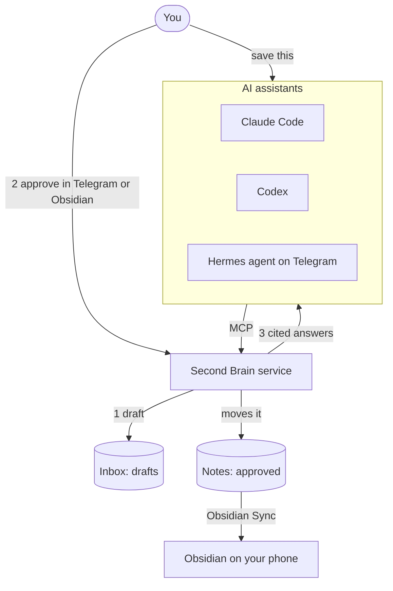

# Second Brain Runtime

A self-hosted memory for AI assistants. Claude Code, Codex, and a Telegram agent save
what you share with them into one Obsidian vault, and you approve each note before it
stays. When you ask a question later, the assistant searches the vault and answers with
links to the notes it used.

## Overview

### The problem

AI assistants forget everything between sessions. A notes app remembers, but saving to it
by hand is slow. If an AI writes to it directly, it fills with unchecked output. Pasting a
whole notes folder into every chat doesn't scale either.

### How it works



1. **Capture.** You paste a link, an article, a video, or a prompt into any assistant and
   say "save this to my brain." The assistant writes a draft note to `Inbox/`.
2. **Review.** You read the draft in Telegram (`/brain_review`) or in Obsidian, then
   approve or discard it. The approval covers the exact version you read. If the draft
   changes after you read it, the approval fails.
3. **Ask.** Later, an assistant asks the brain a question. The brain returns the most
   relevant passages, within a 4,000-token budget, with each note's path and source URL.

### Highlights

- **You stay in control.** An assistant can draft notes but can't approve them. The
  Telegram approval commands run outside the AI model, and each approval is bound to the
  SHA-256 hash of the version you reviewed.
- **Accurate search.** Keyword ranking (BM25) and local embeddings (`bge-m3` on Ollama)
  are combined with reciprocal rank fusion. In a 40-query test on a real 80-note vault,
  the right note ranked first 97% of the time, up from 69% with keywords alone. See
  [the retrieval evaluation](docs/RETRIEVAL_EVALUATION.md).
- **Nothing is lost.** One process writes to the vault. Each write is atomic and becomes
  its own git commit. Discarded and deleted notes move to an archive with a receipt.
- **Private by default.** Notes, embeddings, and the search index stay on your own
  machine. Local clients connect through a relay that reads the access token from a file,
  so no client config holds a secret.
- **Plain files.** The vault is ordinary Markdown that Obsidian opens. The search index
  rebuilds from those files at any time.

### Built with

Python 3.11+, the Model Context Protocol (MCP), SQLite FTS5 and `sqlite-vec`, Ollama,
Docker, [Hermes Agent](https://github.com/NousResearch/hermes-agent), and Obsidian. The
test suite uses pytest.

For component diagrams, the write path, and the trust boundaries, see
[the architecture document](docs/ARCHITECTURE.md). The rest of this README is the
reference for using and running the service.

## Design rules

The Markdown vault is the source of truth. The SQLite index and vectors are disposable.
Exactly one process, the writer, changes vault files, and every write is a git commit in
the vault.

## Everyday flow

1. Paste text, a webpage, a YouTube link, a PDF, a prompt, or a `SKILL.md` into your agent
   and say **"Save this to my brain."**
2. The agent calls `brain_capture`. The note lands in `Inbox/` at once, labeled
   `status: inbox`. It is searchable but ranks below approved notes.
3. Review the inbox in one of three ways:
   - In chat: the agent shows the summary and body verbatim. You approve, and the agent
     calls `brain_approve`.
   - In Telegram with Hermes: send `/brain_review`, read the note, then send `/brain_approve`.
     It approves exactly the version the review showed.
   - In Obsidian: open `Views/Review.base`, set `status: approved` on the note, and the
     next read tool call (or `brain promote`) moves it to `Notes/`.
4. Ask questions with `brain_ask`, list matches with `brain_find`, and read an exact note
   with `brain_read`.

Normal questions never change a file. Raw sources and maps are excluded from retrieval.

## Vault layout

| Path | Contents |
|---|---|
| `Inbox/` | Unreviewed notes (`status: inbox`) |
| `Notes/` | Approved notes, flat (`status: approved`) |
| `Sources/` | Raw captured material, flat, `<source-id>-<title>.md`. Untrusted. |
| `Maps/` | Generated maps and `Tag Registry.md` |
| `Archive/` | Discarded and deleted notes, with a JSON receipt per action in `Archive/Receipts/` |
| `Views/` | Obsidian Bases files, such as `Review.base` |
| `Templates/` | Note templates |
| `.brain-schema.json` | Schema stamp (`schema_version: 4`) |
| `.second-brain/` | Gitignored runtime state: index and write lock |

Folders express lifecycle. Type and domain live in frontmatter, and subject matter lives in
tags.

## Note frontmatter

```yaml
id: note-<12 hex>        # stable across revisions
status: inbox | approved
type: concept | prompt | skill | project | essay
domain: personal | tech
title: <title>
created: <ISO UTC>
updated: <ISO UTC>
reviewed: <ISO UTC>      # set on approval
tags: [kebab-case]       # 1 to 5, registered
aliases: [...]           # optional
sources: ["[[<source stem>]]"]
source_url: <URL>        # optional, with source_kind and source_creator
revises: note-<id>       # inbox only: proposes a revision of that note
```

A note body has `Summary`, optional `Details`, `Connections`, and `Source` sections.

## Approval gate

`approve` refuses a note when any of these fail, and leaves the file unchanged:

- The summary is empty, contains Markdown headings, or exceeds 1500 characters.
- The note has fewer than 1 or more than 5 tags.
- A tag is malformed or missing from `Maps/Tag Registry.md`.
- The type or domain is invalid.
- `revises` names a note that doesn't exist.

Aliases and maps aren't required. `brain_capture` reports these problems as `problems`
without blocking the capture.

Approval binds to `content_sha`, the SHA-256 digest of the inbox file. If the note changes
after review, the approval fails with a mismatch. A `revises` note rewrites the target in
place and keeps its `id`, `created`, and every earlier source. `brain_approve` needs
`user_approved=true` in `chat` approval mode and is refused in `human` mode.

## MCP tools

| Read | Write |
|---|---|
| `brain_find`, `brain_ask`, `brain_read`, `brain_neighbors`, `brain_open`, `brain_list_tags`, `brain_inbox`, `brain_digest`, `brain_report`, `brain_validate` | `brain_capture`, `brain_update_inbox`, `brain_approve`, `brain_discard`, `brain_register_tags`, `brain_prepare_delete`, `brain_commit_delete` |

In `reader` mode, write tools return an error and never touch the vault. Deleting an
approved note takes two steps: `brain_prepare_delete` stages a review, and
`brain_commit_delete` archives the note after you approve that proposal ID. Nothing is
erased permanently. The server sends the usage rules to clients as MCP instructions.

## CLI

```sh
brain [--vault PATH] COMMAND
```

| Command | Use |
|---|---|
| `capture INPUT` | Write an unreviewed note. Options: `--type`, `--domain`, `--title`, `--summary`, `--body-file`, `--tag`, `--alias`, `--creator`, `--source-url`, `--source-kind`, `--revises`, `--connections` |
| `inbox [NOTE_ID]` | List inbox items, or show one in full |
| `approve NOTE_ID [--sha SHA]` | Approve one inbox note as a human |
| `discard NOTE_ID [--reason TEXT]` | Archive an inbox note |
| `promote` | Promote notes approved by editing `status` in Obsidian |
| `digest [--json]` | Short inbox digest |
| `report [--stale-days N]` | Duplicates, orphans, stale inbox items. Changes nothing. |
| `find QUERY [--limit N]` | Find matching notes |
| `ask QUERY [--max-tokens N] [--hops N]` | Retrieve an evidence bundle |
| `reindex` | Refresh the lexical index |
| `embed` | Embed chunks that have no vector |
| `validate` | Check notes against the structural rules |
| `doctor` | Check the runtime, schema stamp, Ollama, and embedding coverage |
| `register-tags TAG...` | Add tags to the registry |
| `migrate-v4` | Migrate a schema 3 vault |

## Configuration

| Variable | Default | Use |
|---|---|---|
| `SECOND_BRAIN_VAULT` | `~/Documents/second-brain` | Vault path. The `--vault` option overrides it. |
| `SECOND_BRAIN_MODE` | `writer` | `writer` or `reader` |
| `SECOND_BRAIN_APPROVAL` | `chat` | `chat` or `human` |
| `SECOND_BRAIN_INDEX_PATH` | `<vault>/.second-brain/index.sqlite3` | Index location. Set it for every reader. |
| `SECOND_BRAIN_HTTP_TOKEN` | unset | Bearer token required on every HTTP request when set |
| `SECOND_BRAIN_ALLOWED_HOSTS` | unset | Comma-separated `Host` header values accepted over HTTP besides loopback, for example `second-brain:8765` on a container network |
| `SECOND_BRAIN_GIT_AUTOCOMMIT` | `1` | `0` turns off the git commit per write |
| `OLLAMA_URL` | `http://localhost:11434` | Embedding server |
| `SECOND_BRAIN_EMBED_MODEL` | `bge-m3` | Embedding model |
| `SECOND_BRAIN_CAPTURE_CACHE` | unset | Scratch directory. After approve or discard, files named for the post ID in `source_url` are deleted. |
| `SECOND_BRAIN_DISABLE_SQLITE_VEC` | unset | `1`, `true`, or `yes` stores vectors as JSON instead of in `sqlite-vec` |

## Run the server

Stdio, for a local client:

```sh
second-brain-mcp
```

Streamable HTTP, with a token:

```sh
SECOND_BRAIN_HTTP_TOKEN=TOKEN second-brain-mcp --transport streamable-http --host 127.0.0.1 --port 8765
```

Clients connect to `http://127.0.0.1:18765/mcp` and send `Authorization: Bearer TOKEN`.
Replace TOKEN with a long random string. The server warns when it listens on a non-loopback
host without a token.

Relay mode, for stdio clients such as Claude Code and Codex. The relay forwards MCP
messages to the writer and reads the token from a file, so no client config holds a secret.
It never opens the vault:

```sh
second-brain-mcp --connect http://127.0.0.1:18765/mcp --token-file ~/.hermes/deployment/second-brain.env
```

Reader mode, for a second client that must not write:

```sh
SECOND_BRAIN_MODE=reader SECOND_BRAIN_INDEX_PATH=/path/to/reader-index.sqlite3 second-brain-mcp
```

The writer starts a background worker that embeds new chunks, and it runs `promote` at
startup. Search uses keyword ranking alone when Ollama is stopped, and fuses it with vector
ranking when embeddings are available.

## Default locations

- Vault: `~/Documents/second-brain`, or the path in `SECOND_BRAIN_VAULT`
- Embeddings: Ollama with `bge-m3`, stored locally
- Search index: `<vault>/.second-brain/index.sqlite3`
- Deployment: the `second-brain` container, staged in [deploy/README.md](deploy/README.md)

## Local maintenance

Run these from the repository root. Replace VAULT with the path to your vault.

```sh
uv sync
uv run pytest
uv run brain --vault VAULT doctor
uv run brain --vault VAULT validate
uv run brain --vault VAULT reindex
uv run brain --vault VAULT embed
uv run brain --vault VAULT inbox
uv run brain --vault VAULT digest
uv run brain --vault VAULT report
```

## Migrate from schema 3

`brain migrate-v4` converts a schema 3 vault. Apply refuses to run unless all of these hold:

- The vault is a git repository.
- The working tree is clean.
- `.brain-schema.json` says `3`.

1. Write a tag map, `{"old-tag": "new-tag", "unwanted-tag": null}`, and a map-tags file,
   `{"Map name": ["tag", ...]}`. Keep both outside the vault.
2. Run the dry run, which is the default and prints the plan as JSON:

   ```sh
   brain --vault VAULT migrate-v4 --dry-run --tag-map tag-map.json --map-tags map-tags.json
   ```

3. Resolve title clashes and unmapped maps in the plan, then apply:

   ```sh
   brain --vault VAULT migrate-v4 --apply --tag-map tag-map.json --map-tags map-tags.json
   ```

The migration makes one git commit. The full deployment sequence, including the snapshot
tag and rollback, is in [deploy/README.md](deploy/README.md).

## More documentation

- [docs/ARCHITECTURE.md](docs/ARCHITECTURE.md): flow, components, and privacy boundary.
- [deploy/README.md](deploy/README.md): schema 4 deployment runbook.
- [docs/RETRIEVAL_EVALUATION.md](docs/RETRIEVAL_EVALUATION.md): retrieval method and results.
- [docs/RESEARCH.md](docs/RESEARCH.md): evaluated local alternatives.

## License

MIT. See [LICENSE](LICENSE).
