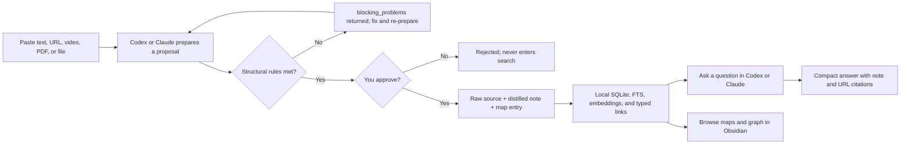

# Architecture and operating model

## User flow

## Storage boundary

- Markdown is authoritative and remains readable without this runtime.
- `.second-brain/index.sqlite3` contains regenerable lexical, vector, and graph indexes.
- Raw material is retained under `Sources/` and explicitly marked as untrusted data.
- A proposal stores a concise `summary` and a separate reviewed Markdown `body`. The
  body appears in the approved note under Details and in the full review preview.
  Older proposals default to an empty body through `Proposal.from_dict`; the vault
  layout and index schema remain compatible.
- Approved notes live at `<Domain>/<Type>/`, where domain is `Personal` or `Tech` and type
  is one of `Notes`, `Prompts`, `Skills`, `Projects`, or `Essays`. `Maps/` holds the index
  notes; `Reviews/` holds proposals.
- Pending and rejected material is never indexed.
- Embeddings are computed locally by Ollama. Only the small excerpts returned to the active
  agent may be sent to its model provider.

## The layout invariant

A note's path is a pure function of two closed sets — its domain and its type — and of
nothing else. Subject matter is carried in tags.

This is the constraint the rest of the design leans on, and it was learned the hard way. An
earlier version routed on a single `kind` string that an agent chose freely at save time,
and that string became a directory. Because `kind` conflated *what a thing is* with *what
it is about*, the vault grew two parallel topic trees for the same material, and `Sources/`
acquired subject folders it should never have had.

Two orthogonal closed sets give a predictable grid instead. A topic can never become a
folder, so material belonging in several places is never forced to pick one parent, and
adding a domain or type is a deliberate edit to `models.py` rather than something a save
decides on its own.

Type folders stay flat. Retrieval runs on search, tags, maps, and links, none of which
consult folder depth, so nesting buys nothing and costs a single-parent choice.

## The structural gate

Guidance written in prose is advice an agent drops under context pressure, so the rules
that keep a note findable are enforced in `validation.check_proposal`, which
`commit_save` runs before opening any file. A proposal is refused unless it carries a
summary that is prose rather than a pasted document, at least two registered tags, at least
two aliases, and at least one map.

Two consequences are deliberate:

- A refusal leaves the vault byte-for-byte unchanged, and the proposal stays pending, so a
  blocked save is always resumable.
- `brain_prepare_save` reports the same failures up front as `blocking_problems`, so they
  surface while they still cost nothing, rather than after the user has approved something
  that will then refuse to commit.

Because the gate asks agents to fix and re-prepare, and re-preparing mints a new proposal
id, `prepare_save` retires any pending proposal holding identical content from the same
source and destination. Separate task notes from one source retain distinct proposals. Otherwise every blocked save would strand its earlier attempt in the queue forever.

Notes edited by hand bypass all of this, so `validation.lint_vault` applies the same rules
to the whole vault and reports what fails, reachable as `brain_validate` or `brain validate`.

## Schema version

The runtime and the vault are separate repositories. That keeps reusable code apart from
private writing, but it means either can be rolled back without the other, and a layout
change is exactly the kind of edit that spans both — the move to `<Domain>/<Type>/` altered
`models.py` and relocated every note in the same breath.

`SCHEMA_VERSION` names the layout the code produces and is stamped into the vault as
`.brain-schema.json`. The file is tracked, not kept under the gitignored index, so it
travels with a clone rather than being regenerated to whatever the local code believes.

Comparison happens in `_check_schema`, which runs *before* `_ensure_layout` creates or
retires anything, and deliberately does not raise. On a mismatch the runtime returns without
touching the vault at all: reorganising a vault written for a different layout is precisely
the damage the stamp exists to prevent, and opening one is a read.

A mismatch then blocks writes through `_require_matching_schema` while leaving retrieval
working, since reading a vault whose layout has moved is harmless. Both `doctor` and
`validate` report it, so the condition is visible before anyone tries to save.

Retiring a folder requires it to be completely empty, not merely free of Markdown. The
weaker guard made attachments collateral: a PDF or image left in a retired folder was
deleted because it was not a note.

## Retrieval

Search combines SQLite full-text matching, local `bge-m3` embeddings, and one-hop typed
links, then obeys a configurable context budget. Results include paths and original URLs.

The two arms are combined by reciprocal rank fusion using each document's *best* rank within
an arm. Summing a term for every matching chunk instead — which the first implementation did
— scores documents by length, and since a raw capture runs many times longer than the note
distilled from it, sources became structurally impossible to outrank. Distilled notes then
take a small additional weight over raw sources, which stay searchable and citable.

Maps need two adjustments, because a map lists the title and summary of every note it
indexes. It is demoted slightly, or it would match almost any query about its subject and
crowd out the notes themselves; and it is excluded from graph expansion, since every note
links to its map and hops through one would make everything on it look mutually related.

Graph scores are computed from a snapshot of the direct scores. Reading the live table let a
score awarded to a neighbour be re-propagated when that neighbour came up as a later seed,
compounding one hop into an arbitrarily large one.

Supported typed relationships are `about`, `created-by`, `contradicts`, `derived-from`,
`requires`, `similar-to`, `supports`, and `uses`. Links work in both directions during
retrieval.

## Write safety

Capture is deliberately split into two calls. Preparing creates only a pending review note.
Committing requires a proposal ID plus explicit approval. This prevents an ordinary
question, retrieved prompt, or malicious webpage from silently changing approved knowledge.

The rules agents must follow are published as MCP server instructions rather than kept only
in the vault's `AGENTS.md`, because that file is loaded only when a session's working
directory is inside the vault. A containerised agent answering from a chat platform would
never see it.

## Migration

The pilot migration is copy-only. It reads a bounded set of notes from the old vault and
creates pending proposals in the new vault. Nothing is automatically approved and the source
vault is not changed. Imported proposals arrive without aliases or maps on purpose, so each
one must be curated before the gate will let it commit — that is what stops a bulk import
from dumping unfindable notes into the library.
