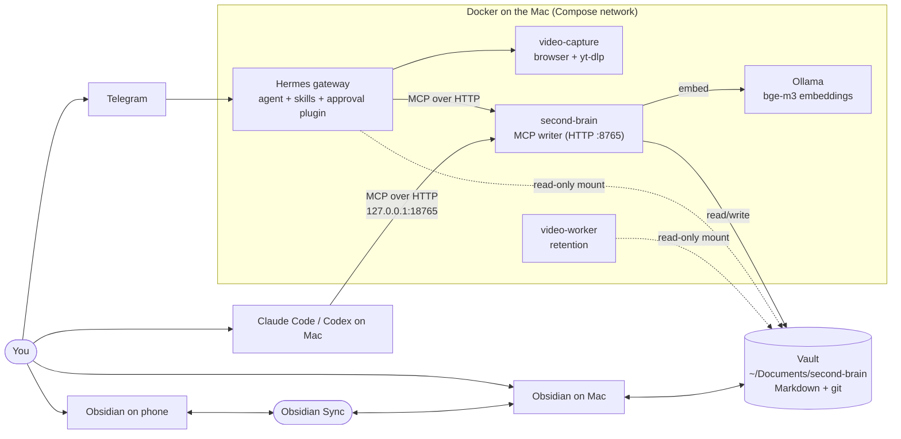
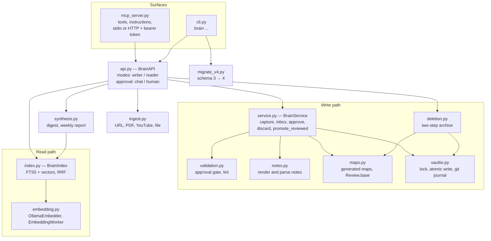
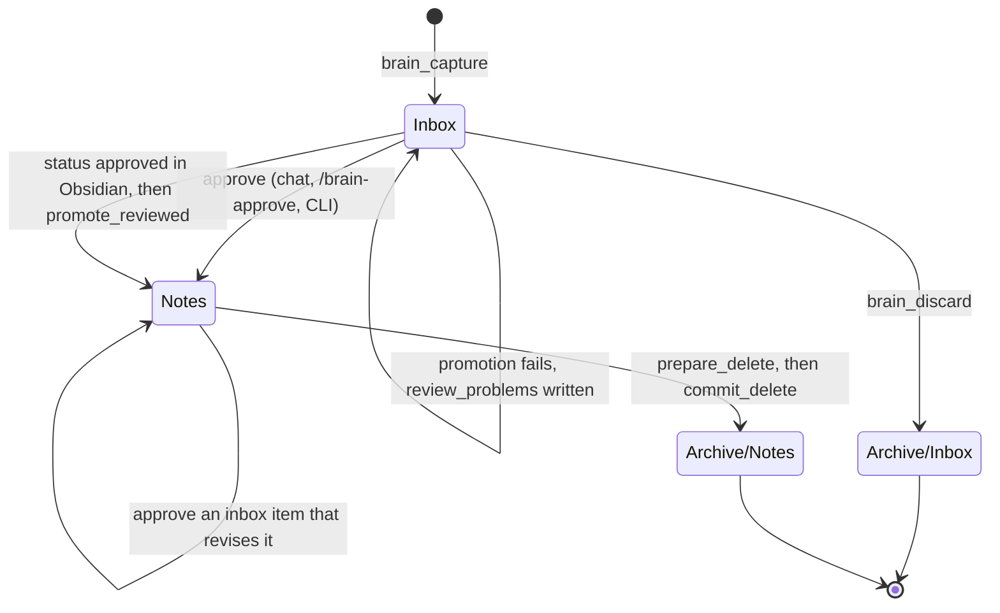
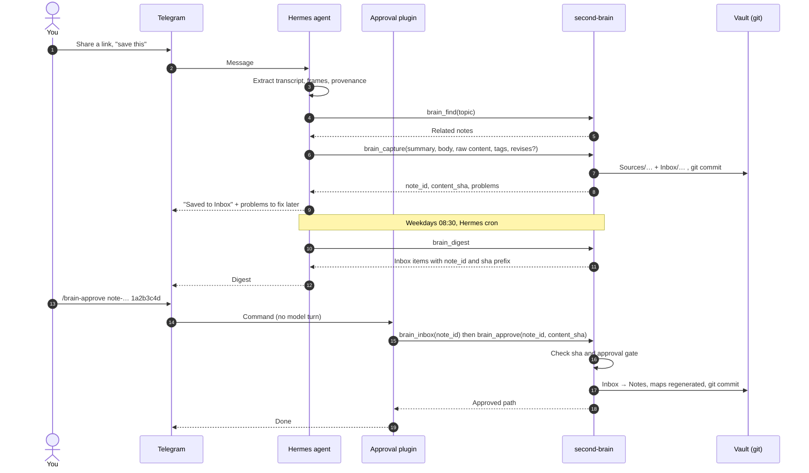
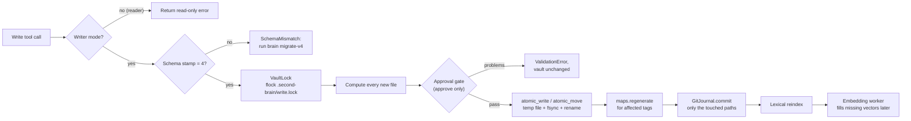
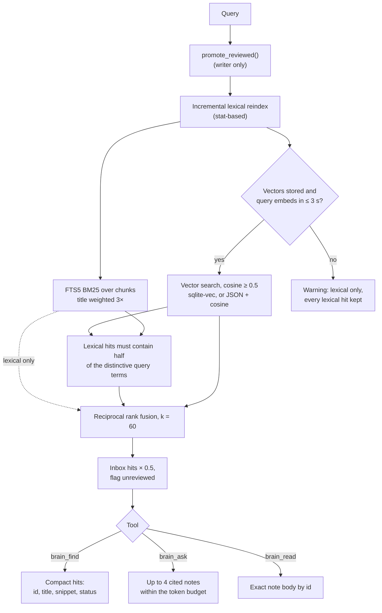
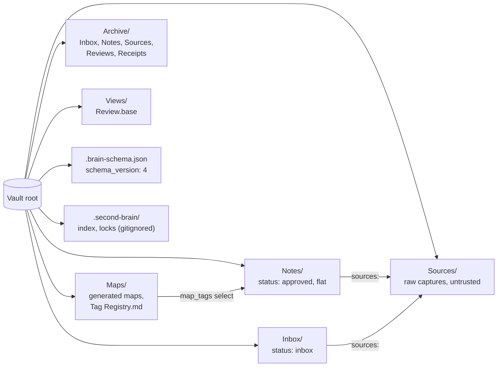
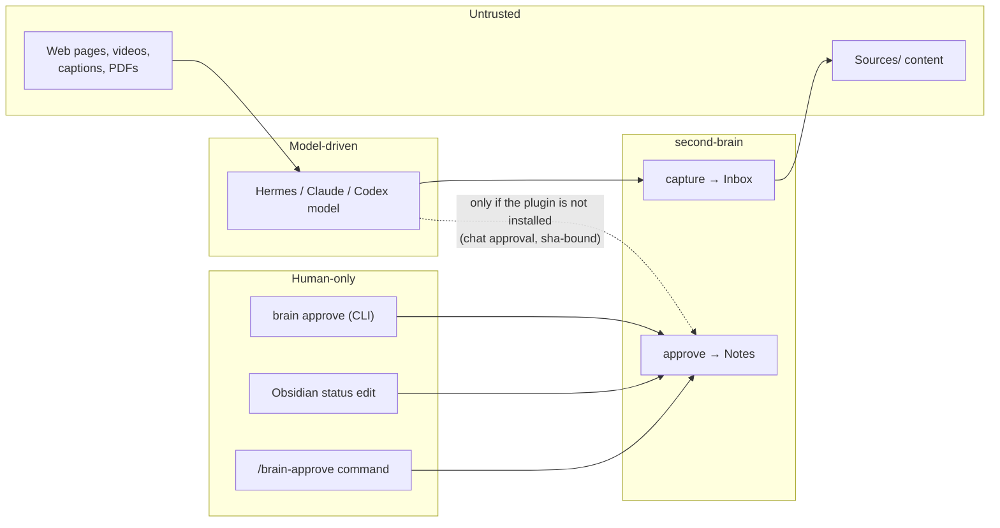
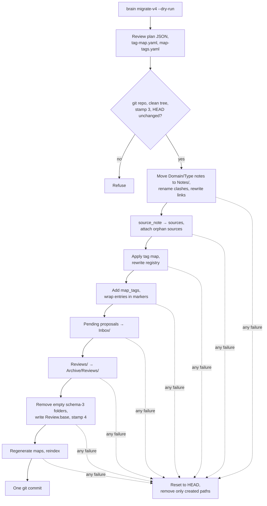
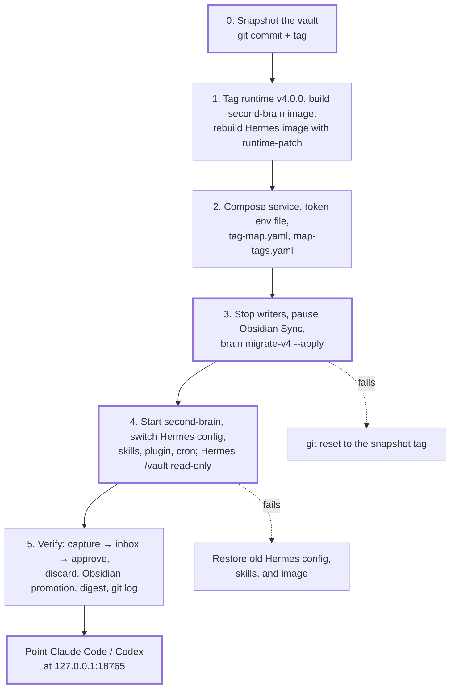

# Second brain architecture (schema 4)

The second brain is a Markdown knowledge vault in Obsidian with one service that writes
to it. Agents capture material into an inbox in a single call. You review the inbox in
batches, in chat, in Telegram, or in Obsidian. Approved notes become the trusted
library. Search covers both, and it labels inbox items as unreviewed.

The rest of this page shows the system from the outside in: where each part runs, how a
capture becomes a note, how search ranks results, and how the service keeps the vault
consistent.

## System context

| Part | Runs where | Role |
|---|---|---|
| `second-brain` | Its own container, pinned to a tagged runtime build | The only process that writes the vault. Serves MCP over streamable HTTP. |
| Hermes | `hermes` container | Telegram agent. Extracts content, calls brain tools, sends the daily digest. |
| Approval plugin | Inside Hermes | Runs `/brain-approve` without a model turn, so approval comes from you, not the model. |
| Ollama | `ollama` container | Local `bge-m3` embeddings. No note text leaves the machine for embedding. |
| Vault | Mac file system, bind-mounted | Source of truth. Git records every write. Obsidian Sync carries it to the phone. |
| Claude Code, Codex | Mac | Connect to the writer over HTTP on `127.0.0.1`, or run a read-only stdio server. |

## Runtime modules

`models.py` holds the shared constants and result types that every module imports.

## Note lifecycle

- **Inbox** notes are searchable at once, ranked at half weight, and marked
  `unreviewed`. They never appear on maps.
- **Approval** binds to `content_sha`, the SHA-256 of the inbox file you reviewed. Any
  later edit changes the hash, and the approval no longer applies.
- **A revision** keeps the note's `id` and `created` date and appends the new source to
  `sources`. Git keeps the previous text.
- **Archive** moves never delete. Each archive action writes a receipt.

## Capture and review

You can also approve in Obsidian. Open **Views/Review.base**, change `status` to
`approved`, and the writer promotes the note the next time it runs a tool or restarts.
When the gate fails, the note stays in `Inbox/` and its `review_problems` property says why.

When the approval plugin is installed, Hermes hides `brain_approve` from the model. A
prompt injection in captured content can then write to the inbox, but it can't approve
anything.

## Write path

- One writer process plus a file lock removes write races between clients.
- Atomic renames mean a crash leaves either the old file or the new one, never half of one.
- The git journal commits only the paths a write touched, so your own uncommitted edits
  stay out of brain commits. Git never pushes.
- Embedding runs on a background thread. A slow or stopped Ollama never blocks a save.

## Search

When vectors are available, a lexical hit must also contain at least half of the
distinctive query terms. Prefix matching otherwise returns loosely related notes for
questions the vault can't answer. On the real-vault evaluation, hybrid search raised
top-1 accuracy from 0.71 to 0.97 and no-answer accuracy from 0.20 to 1.00. For the
method and caveats, see `docs/RETRIEVAL_EVALUATION.md`.

Search indexes `Notes/` and `Inbox/` only. Sources, maps, and archive are excluded, so raw
transcripts and listings can't crowd out distilled notes. The index lives in
`.second-brain/index.sqlite3`, or at `SECOND_BRAIN_INDEX_PATH`, and can be rebuilt from the
Markdown at any time. Vectors are stored as JSON in the index. When the `sqlite-vec`
extension loads, the index mirrors them in a `vec0` table for faster search.

## Vault layout

Folders express lifecycle. Type (`concept`, `prompt`, `skill`, `project`, `essay`) and
domain (`personal`, `tech`) are frontmatter properties, checked against closed sets in
code. Topic lives in tags from `Maps/Tag Registry.md`. A map is a note with `map_tags`.
The service rewrites only the block between `<!-- brain:generated:start -->` and
`<!-- brain:generated:end -->`, so text you write around it stays.

## Approval gate

A note can't reach `Notes/` unless it has:

- a prose summary without Markdown headings, up to 1,500 characters;
- one to five tags, all registered;
- a valid type and domain;
- a `revises` target that exists, for a revision.

Capture accepts notes that fail these rules and reports the problems. Approval refuses
them.

## Trust boundaries

- The writer listens on the Compose network. The host publishes it only on
  `127.0.0.1:18765`, and every request needs the bearer token.
- Captured text is stored as data and marked untrusted. Tools never act on instructions
  in it.
- Embeddings run locally. Only the small evidence packs that search returns go to the
  active agent's model provider.

## Background jobs

| Job | Where | Schedule | Effect |
|---|---|---|---|
| Embedding worker | `second-brain` thread | Every 30 seconds, with backoff | Fills missing vectors. |
| Promote reviewed | `second-brain` | Startup and before reads | Promotes inbox notes you approved in Obsidian. |
| Inbox digest | Hermes cron | Weekdays 08:30 | Sends the inbox list to Telegram. |
| Weekly report | Hermes cron | Sundays 18:00 | Duplicates, unlinked notes, tags without maps, stale inbox, orphan sources. Report only. |
| Video retention | `video-worker` | Hourly | Prunes captured media after its note is approved or discarded. |

## Migration from schema 3

The deployment runbook in `deploy/README.md` orders the live steps: snapshot the vault,
build the pinned image, migrate, switch Hermes, verify, and roll back if needed.

## Rollout

Steps with a thick border change live state. `deploy/README.md` holds the exact
commands and the rollback for each step.

