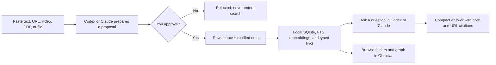

# Architecture and operating model

## User flow

## Storage boundary

- Markdown is authoritative and remains readable without this runtime.
- `.second-brain/index.sqlite3` contains regenerable lexical, vector, and graph indexes.
- Raw material is retained under `Sources/` and explicitly marked as untrusted data.
- Approved summaries live in `Prompts/`, `Skills/`, `Resources/`, `Knowledge/`, or `Projects/`.
- Pending and rejected material is never indexed.
- Embeddings are computed locally by Ollama. Only the small excerpts returned to the active agent may be sent to its model provider.

## Retrieval

Search combines SQLite full-text matching, local `bge-m3` embeddings, and one-hop typed links. Results favor distilled notes over raw sources, include paths and original URLs, and obey a configurable context budget.

Supported typed relationships are `about`, `created-by`, `contradicts`, `derived-from`, `requires`, `similar-to`, `supports`, and `uses`. Links work in both directions during retrieval.

## Write safety

Capture is deliberately split into two calls. Preparing creates only a pending review note. Committing requires a proposal ID plus explicit approval. This prevents an ordinary question, retrieved prompt, or malicious webpage from silently changing approved knowledge.

## Migration

The pilot migration is copy-only. It reads a bounded set of notes from the old vault and creates pending proposals in the new vault. Nothing is automatically approved and the source vault is not changed.
